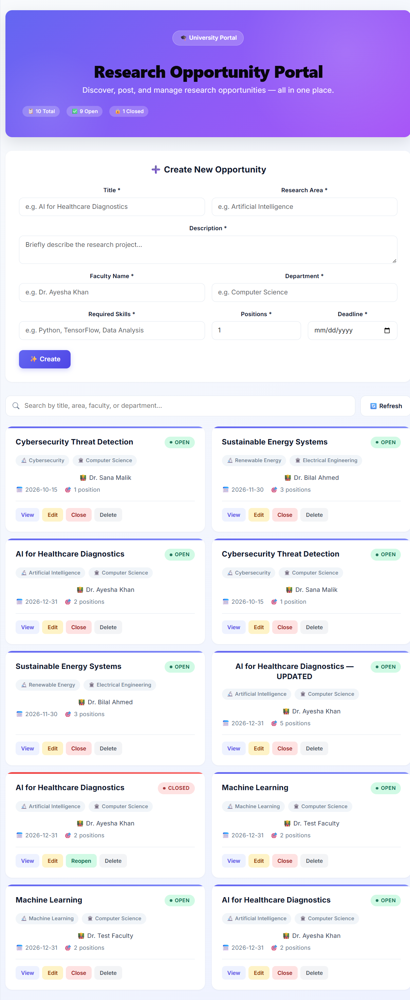
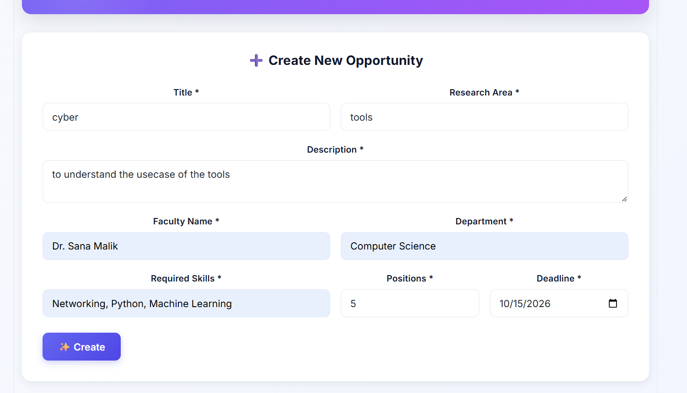
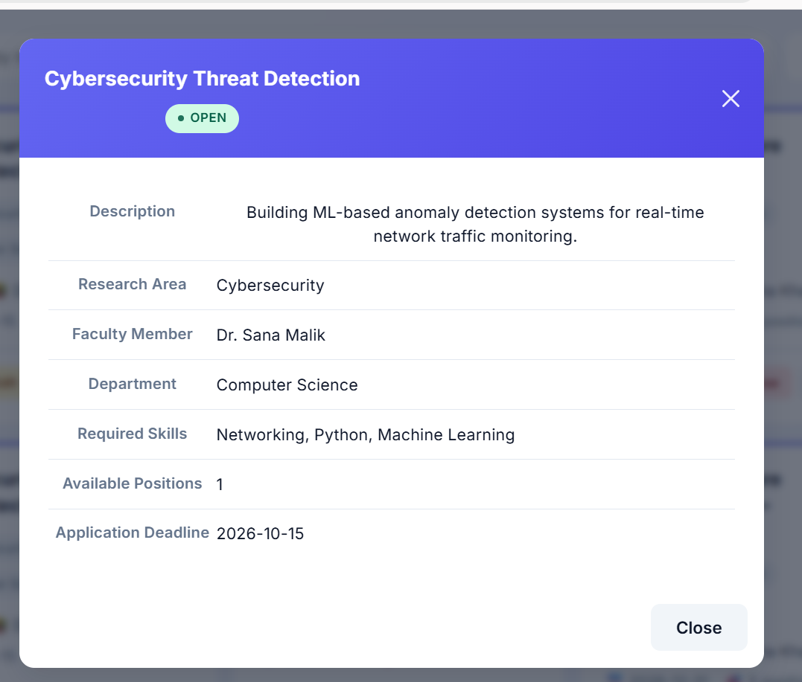
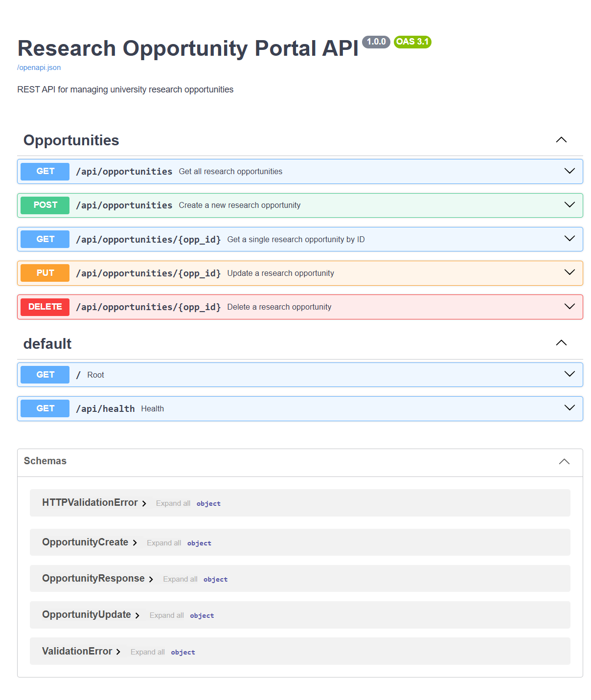
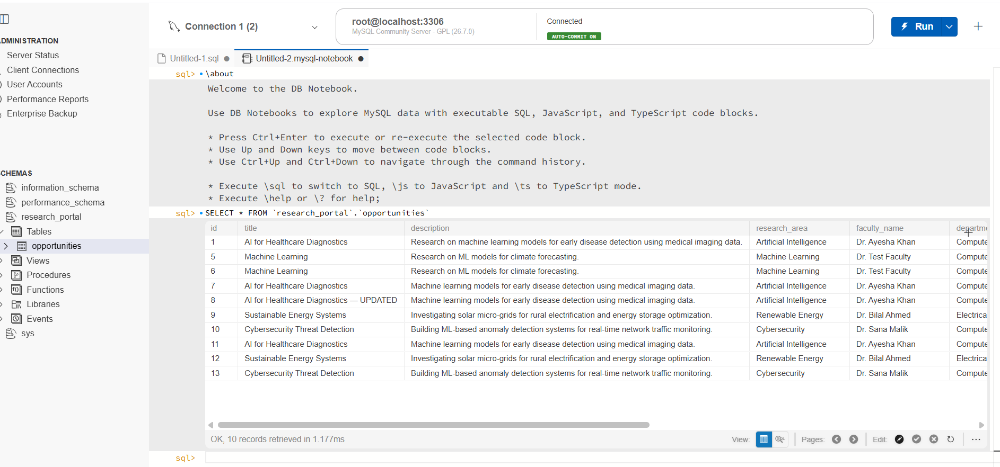

# 🎓 Research Opportunity Portal

> A centralized web-based portal for managing university research opportunities — built to replace scattered emails, WhatsApp groups, and noticeboards.



[](https://fastapi.tiangolo.com/)
[](https://react.dev/)
[](https://www.mysql.com/)
[](https://www.python.org/)

---

## 📌 Overview

Faculty members can **post, view, update, and manage** research opportunities in one place. Students can **browse all available opportunities** with complete details — no more missed opportunities due to scattered information.

### ✨ Features

- ✅ **Create** new research opportunities with full details
- ✅ **View** all opportunities in a responsive card layout
- ✅ **Search** opportunities by title, area, faculty, or department
- ✅ **Update** existing opportunities (title, skills, positions, deadline, etc.)
- ✅ **Close/Reopen** opportunities with one click (Open ↔ Closed status)
- ✅ **Delete** opportunities that are no longer needed
- ✅ **Validation** of all inputs (both frontend and backend)
- ✅ **Consistent error handling** (400, 404, 422, 500 responses)
- ✅ **Auto-generated API documentation** via Swagger UI

---

## 🛠️ Tech Stack

| Layer           | Technology                          |
|-----------------|-------------------------------------|
| **Backend**     | Python 3.12 + FastAPI + SQLAlchemy  |
| **Database**    | MySQL 8.0 (via mysql-connector)     |
| **Frontend**    | React 19 + Vite + Bootstrap 5       |
| **HTTP Client** | Axios                               |
| **Testing**     | Postman                             |

---

## 📂 Project Structure

```
research-opportunity-portal/
├── backend/                    # FastAPI application
│   ├── app/
│   │   ├── core/               # Config & database setup
│   │   ├── controllers/        # Business logic
│   │   ├── middleware/         # Exception handlers
│   │   ├── models/             # SQLAlchemy models
│   │   ├── routes/             # API route definitions
│   │   ├── schemas/            # Pydantic schemas
│   │   └── main.py             # FastAPI entry point
│   ├── .env.example            # Environment template
│   ├── requirements.txt        # Python dependencies
│   └── venv/                   # Virtual environment (not committed)
├── frontend/                   # React application
│   ├── src/
│   │   ├── api/                # Axios client
│   │   ├── components/         # Reusable UI components
│   │   ├── services/           # API service functions
│   │   ├── App.jsx             # Main component
│   │   └── main.jsx            # React entry point
│   └── package.json
├── database/
│   └── schema.sql              # MySQL schema + seed data
├── postman/
│   └── Research_Opportunity_Portal.postman_collection.json
├── docs/
│   └── screenshots/            # README images
└── README.md
```

---

## ⚙️ Setup Instructions

### Prerequisites

- **Python 3.12+** — [Download](https://www.python.org/downloads/)
- **Node.js 20+** — [Download](https://nodejs.org/)
- **MySQL 8.0+** — [Download](https://dev.mysql.com/downloads/)
- **Git** — [Download](https://git-scm.com/)

---

### 1️⃣ Database Setup

1. Open **MySQL Workbench** and connect to your local server.

2. Open `database/schema.sql` via **File → Open SQL Script**.

3. Execute the script (⚡ lightning icon or `Ctrl + Shift + Enter`).

4. Refresh the SCHEMAS panel — you should see `research_portal` with the `opportunities` table and 3 seed rows.

---

### 2️⃣ Backend Setup

```bash
# Navigate to backend
cd backend

# Create virtual environment
python -m venv venv

# Activate venv
# Windows (Git Bash):
source venv/Scripts/activate
# Windows (PowerShell):
.\venv\Scripts\Activate.ps1
# macOS/Linux:
source venv/bin/activate

# Install dependencies
pip install -r requirements.txt

# Create .env from template
cp .env.example .env
```

**Edit `.env`** — set your MySQL password:

```
DB_HOST=localhost
DB_PORT=3306
DB_USER=root
DB_PASSWORD=your_mysql_password_here
DB_NAME=research_portal
```

**Run the backend:**

```bash
uvicorn app.main:app --reload
```

Backend runs at: **http://127.0.0.1:8000**
Swagger UI at: **http://127.0.0.1:8000/docs**

---

### 3️⃣ Frontend Setup

**Open a new terminal:**

```bash
cd frontend
npm install
npm run dev
```

Frontend runs at: **http://localhost:5173**

---

### 4️⃣ Running the Full Application

You need **two terminals** running simultaneously:

| Terminal | Command | URL |
|----------|---------|-----|
| **Terminal 1** | `cd backend && source venv/Scripts/activate && uvicorn app.main:app --reload` | http://localhost:8000 |
| **Terminal 2** | `cd frontend && npm run dev` | http://localhost:5173 |

Open the app: **http://localhost:5173**

---

## 🔌 API Endpoints

Base URL: `http://localhost:8000/api`

| Method | Endpoint | Description | Success | Errors |
|--------|----------|-------------|---------|--------|
| `POST` | `/opportunities` | Create a new opportunity | `201 Created` | `400`, `422` |
| `GET` | `/opportunities` | Retrieve all opportunities | `200 OK` | `500` |
| `GET` | `/opportunities/{id}` | Retrieve one by ID | `200 OK` | `404` |
| `PUT` | `/opportunities/{id}` | Update an opportunity | `200 OK` | `400`, `404` |
| `DELETE` | `/opportunities/{id}` | Delete an opportunity | `200 OK` | `404` |

### Example Request

```bash
curl -X POST http://localhost:8000/api/opportunities \
  -H "Content-Type: application/json" \
  -d '{
    "title": "AI for Healthcare Diagnostics",
    "description": "ML models for early disease detection.",
    "research_area": "Artificial Intelligence",
    "faculty_name": "Dr. Ayesha Khan",
    "department": "Computer Science",
    "required_skills": "Python, TensorFlow",
    "available_positions": 2,
    "application_deadline": "2026-12-31",
    "status": "Open"
  }'
```

---

## 📮 Postman Testing

The `postman/` folder contains an exported collection with **10 pre-configured requests** covering every CRUD operation plus validation scenarios.

### How to Import

1. Open Postman.
2. Click **Import** → **File**.
3. Select `postman/Research_Opportunity_Portal.postman_collection.json`.
4. The collection appears in your sidebar with all 10 requests.

### Test Sequence

| # | Request | Expected |
|---|---------|----------|
| 1–3 | Create Opportunity × 3 | `201 Created` |
| 4 | Get All | `200 OK` |
| 5 | Get One by ID | `200 OK` |
| 6 | Update | `200 OK` |
| 7 | Close (Open → Closed) | `200 OK` |
| 8 | Delete | `200 OK` |
| 9 | Get Deleted | **`404 Not Found`** |
| 10 | Invalid Request | **`422 Unprocessable Entity`** |

> ⚠️ Make sure the backend is running before sending any request.

---

## 📸 Screenshots

### Main Portal


### Create Form


### Details Modal


### Swagger UI


### Postman Collection


### MySQL Database


---

## 🔗 Links

- **GitHub Repository:** [Ibbad-Sec/research-opportunity-portal](https://github.com/Ibbad-Sec/research-opportunity-portal)
- **Demo Video:** *(link to be added)*

---

## 📝 Credits

- **Developer:** Ibbad Ur Rehman ([@Ibbad-Sec](https://github.com/Ibbad-Sec))
- **Course:** *(computer networks)*
- **Instructor:** *(Khizar Mukhtiar)*
- **Institution:** *(Fast Nuces)*

---

## 📄 License

This project was developed as part of a university assignment.